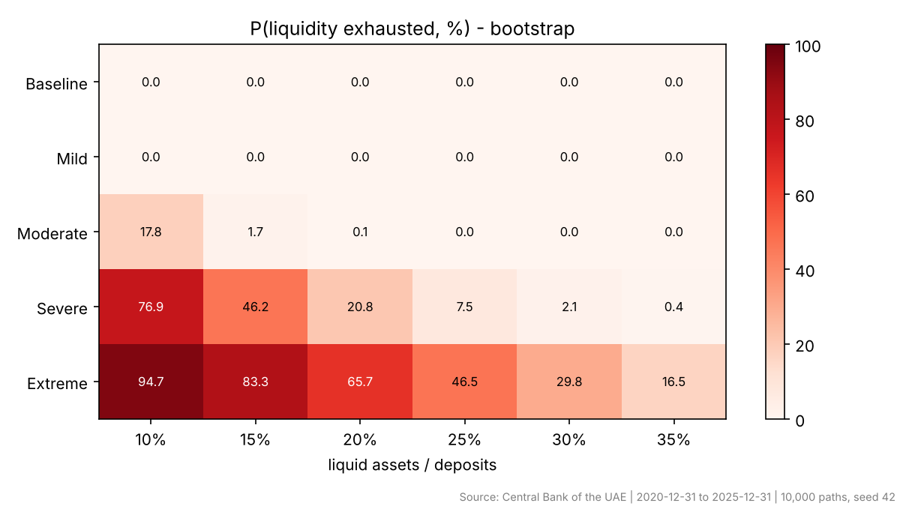

# Monte Carlo Liquidity Stress Testing — UAE Banking Sector

Monte Carlo simulation of 30-day deposit outflows for a stylised UAE bank, calibrated on Central Bank of the UAE aggregate deposit statistics (2020-12-31 to 2025-12-31).

**Headline:** with liquid assets of 25% of deposits, the stylised bank withstands stress up to the Moderate scenario but is exhausted in 7.5% of Severe paths. Surviving 99% of Severe-scenario paths needs about 32.9% of deposits in liquid assets.



## Method in brief
- Historical quarterly deposit growth (20 observations, scaled from quarterly to 30 days) gives the volatility of ordinary flows (normal fit and bootstrap).
- Five hypothetical stress scenarios add Beta-distributed run-offs (0–25% mean).
- 10,000 paths per scenario; outputs are exhaustion probability, 99th-percentile outflow, expected shortfall and the liquidity buffer needed for 95/99/99.9% survival.
- Validation: normal vs bootstrap comparison and Monte Carlo convergence (1k/10k/50k paths).

Full write-up: [report/research_report.md](report/research_report.md)

## Results
| Scenario | P(liquidity exhausted) | 99% buffer (% of deposits) |
|---|---|---|
| Baseline | < 0.03% | 1.8% |
| Mild | < 0.03% | 7.5% |
| Moderate | < 0.03% | 15.9% |
| Severe | 7.48% | 32.9% |
| Extreme | 46.49% | 51.9% |

## Reproduce
```
pip install -r requirements.txt
python src/liquidity_stress.py --csv data/cbuae_deposits_quarterly.csv --frequency quarterly
```
The input data are not redistributed here. `DATA.md` explains how to rebuild `data/cbuae_deposits_quarterly.csv` from the CBUAE Monthly Statistical Bulletin.

## Repository
```
src/liquidity_stress.py   all code: data check, simulation, figures, write-up
results/                  derived statistics (CSV)
figures/                  charts
report/research_report.md full report
DATA.md                   data source and attribution
```

Data source: Central Bank of the UAE. Analysis and code by Veer Kapoor.
