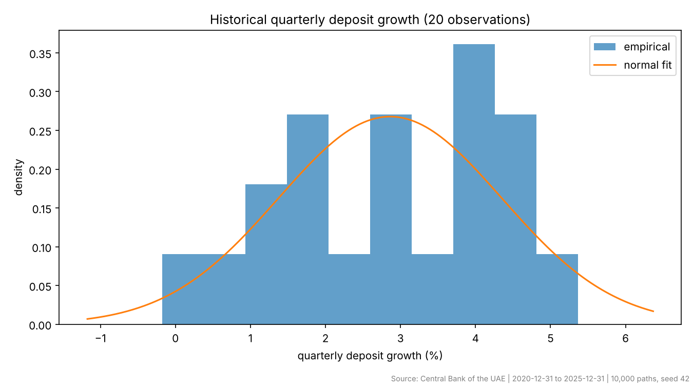
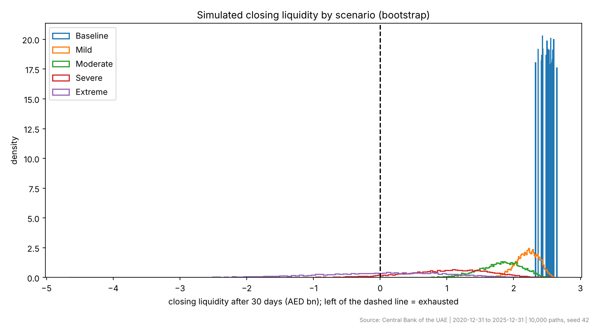
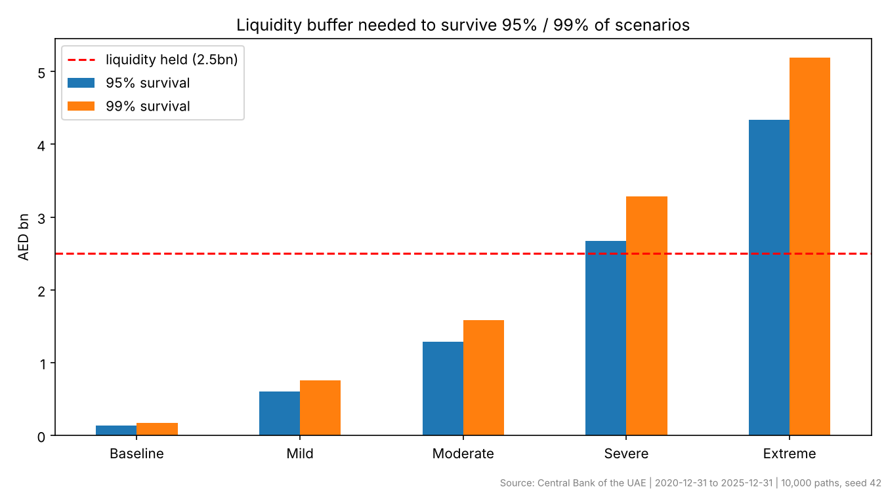

# Monte Carlo Liquidity Stress Testing of the UAE Banking Sector

*Veer Kapoor · October 2026*

## Abstract
Quarterly aggregate bank-deposit data from the Central Bank of the UAE (2020-12-31 to 2025-12-31, 20 quarterly changes) are used to calibrate a Monte Carlo model of 30-day deposit outflows for a stylised bank holding AED 10bn of deposits and AED 2.5bn (25%) of liquid assets. Across 10,000 simulated paths per scenario and five stress levels, the stylised bank withstands stress up to the Moderate scenario but is exhausted in 7.5% of Severe paths. Surviving 99% of Severe-scenario paths would require liquid assets of about 32.9% of deposits.

## 1. Introduction
Liquidity risk is the risk that a bank cannot meet withdrawals as they fall due. Regulators address it through buffers such as the Basel III Liquidity Coverage Ratio, which requires banks to hold enough high-quality liquid assets to survive a 30-day stress. This project asks a simplified version of the same question: how likely is a stylised UAE bank to exhaust its liquid assets over 30 days, and how large a buffer would protect it under progressively harsher assumptions?

## 2. Data
- **Source:** Central Bank of the UAE, Monthly Statistical Bulletin (banking and monetary statistics). See `DATA.md` for the exact series and how to rebuild the input file.
- **Series:** "Deposits" (excluding inter-bank), Table 1 "Selected Monetary and Banking Indicators", AED million, quarter-end values, 2020-12-31 to 2025-12-31. Where a figure was revised in a later bulletin, the latest published value is used.
- **Processing:** quarter-end dates; duplicates and unparseable rows removed; a data-quality check flags any quarterly move above 12% for verification against the source.
- **Frequency:** quarter-end values are used because Table 1 reports quarters for most of the period. Quarterly growth is converted to a 30-day equivalent assuming independent months (mean ÷ 3, standard deviation ÷ √3).
- **Redistribution:** the raw series is not included in this repository; only derived statistics are published.

| Statistic | Value |
|---|---|
| Mean quarterly growth | 2.86% |
| Standard deviation (quarterly) | 1.49% |
| Skewness | -0.35 |
| Excess kurtosis | -0.64 |
| Worst quarter | -0.17% (2021-03) |
| 5th percentile quarter | 0.45% |
| 30-day equivalent mean / standard deviation | 0.95% / 0.86% |

## 3. Methodology
For each scenario the 30-day net outflow, as a share of deposits, is

*w = R − (μ + k·ε)*

where *ε* is a 30-day-equivalent deviation of deposit growth (quarterly deviations divided by √3) drawn either from a normal distribution with the historical standard deviation (**Normal**) or by resampling historical deviations (**Bootstrap**); *k* scales volatility; *R* is an additional run-off drawn from a Beta distribution with the scenario's mean and a standard deviation equal to 40% of that mean; and *μ* is set to zero, so organic deposit growth is not relied on (a conservative choice).

Closing liquidity is *L_end = L₀ − w·D₀*. The bank is **exhausted** when *L_end < 0*. Each scenario uses 10,000 paths (seed 42).

**Stress ladder (hypothetical assumptions):**

| Scenario | Volatility multiplier | Mean extra run-off |
|---|---|---|
| Baseline | 1x | 0% |
| Mild | 1.5x | 3% |
| Moderate | 2x | 7% |
| Severe | 3x | 15% |
| Extreme | 3x | 25% |

Run-off levels are illustrative and should be read alongside Basel III LCR run-off assumptions for different deposit types.

## 4. Results
| Scenario | P(exhaust) % bootstrap (95% CI) | P(exhaust) % normal | 99th pct outflow % | ES99 outflow % | 99% buffer, % of deposits | Surplus (+) / shortfall (−) vs held, AED bn |
|---|---|---|---|---|---|---|
| Baseline | < 0.03 | < 0.03 | 1.8 | 1.8 | 1.8 | +2.32 |
| Mild | < 0.03 | < 0.03 | 7.5 | 8.3 | 7.5 | +1.75 |
| Moderate | < 0.03 | 0.01 | 15.9 | 17.4 | 15.9 | +0.91 |
| Severe | 7.48 (±0.52) | 7.52 | 32.9 | 35.7 | 32.9 | -0.79 |
| Extreme | 46.49 (±0.98) | 46.78 | 51.9 | 57.4 | 51.9 | -2.69 |

Liquidity is resilient (exhaustion probability at or below 1%) up to the **Moderate** scenario and becomes vulnerable under **Severe**, where it is exhausted in 7.5% of simulated paths.

**Liquidity needed to keep exhaustion at or below 1%** (bootstrap; grid of 10–35% of deposits):

| Scenario | Minimum liquid assets / deposits |
|---|---|
| Baseline | 10% |
| Mild | 10% |
| Moderate | 20% |
| Severe | 35% |
| Extreme | > 35% |

## 5. Validation
- **Model comparison:** Normal and bootstrap calibrations give statistically indistinguishable exhaustion probabilities in every scenario (differences within two combined standard errors). Because ordinary deposit volatility is small relative to the hypothetical run-offs, the scenario assumptions, not the shape of the historical distribution, drive the results.
- **Monte Carlo error:** Under the Severe scenario the exhaustion probability is 7.48% with 10,000 paths and 7.42% with 50,000 paths - within sampling error, so 10,000 paths is sufficient.
- **Zero probabilities** are reported as an upper bound (rule of three: fewer than 0.03% for 10,000 paths), not as impossibility.

## 6. Limitations
- A stylised bank calibrated on system-wide aggregates; not a model of any individual institution and not a regulatory stress test.
- Stress run-offs are assumptions; conclusions are conditional on them.
- Quarterly data are scaled to a 30-day horizon by assuming independent months, so within-quarter swings, seasonality and intra-month timing are not captured. Asset-side stress (fire-sale haircuts, credit-line drawdowns) is not modelled.
- The bootstrap can only reuse the 20 observed quarterly changes, so its tails are limited by the sample. With only 20 observations, tail estimates are uncertain; a monthly series would strengthen them.

## 7. Conclusion
Liquidity is resilient (exhaustion probability at or below 1%) up to the **Moderate** scenario and becomes vulnerable under **Severe**, where it is exhausted in 7.5% of simulated paths. Normal and bootstrap calibrations give statistically indistinguishable exhaustion probabilities in every scenario (differences within two combined standard errors). For a risk manager, the practical output is the buffer table: it translates a chosen confidence level and stress assumption into a liquid-asset target, and the sensitivity grid shows how quickly risk falls as that target rises.

## Reproducibility
`python src/liquidity_stress.py --csv data/cbuae_deposits_quarterly.csv --frequency quarterly` reproduces every number and figure (data fingerprint `fb20b1636634`).
